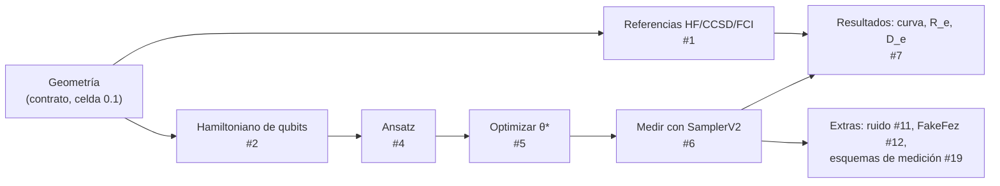

# ELI5: qué hace este proyecto y cómo leerlo

Guía para ingenieros de software que no son físicos. Frases cortas, cada término se explica una vez. Para el vocabulario completo, ver [`docs/glosario.md`](../glosario.md). Para el porqué de las decisiones de infraestructura, ver [`docs/adr/`](../adr/README.md).

## El problema en términos cotidianos

Tenemos 4 átomos de hidrógeno en fila (H₄), como 4 bolitas en un palito. Los separamos de a poco, de 0,6 Å a 3,0 Å (un ångström, Å, es una diezmilmillonésima de metro). A cada distancia `d` queremos saber **cuánta energía tiene la molécula**. Menos energía significa más estable.

Piensen en la energía como la altura de una pelota en un paisaje con valles. El valle más profundo es el estado fundamental. La curva `E(d)` es la altura de ese valle para cada distancia.

Cuando los átomos están cerca, los métodos clásicos (CCSD) aciertan. Cuando están lejos (`d ≥ 1,8 Å`), los electrones se vuelven "indecisos" y CCSD se equivoca. El desafío es ganarle a CCSD en esa zona usando un algoritmo cuántico, el VQE. Las reglas están en `docs/challenge/`.

Tres siglas que van a aparecer:

- **FCI**: la respuesta exacta (en la base STO-3G, una receta chica y fija para describir los electrones). Es cara pero con 4 átomos se puede. La usamos como "verdad" para medir errores.
- **CCSD**: el método clásico que hay que superar.
- **mHa**: milihartree, la unidad de energía. 1,6 mHa es "precisión química".

## VQE: adivinar, medir, ajustar

VQE es un bucle de tres pasos. Se parece a afinar una guitarra de oído:

1. **Adivinar.** Un circuito cuántico con perillas (los parámetros θ) prepara un estado. Ese circuito se llama *ansatz*.
2. **Medir.** Se mide la energía de ese estado. En un chip real el resultado es ruidoso: cada medición ("shot") da un 0 o un 1 por qubit, y hay que promediar miles.
3. **Ajustar.** Un optimizador clásico mueve las perillas para bajar la energía. Se repite.

Al final nos quedamos con los mejores parámetros θ\*. Después hacemos una medición final con shots reales y esa es la energía que reportamos, con su barra de error ±σ (σ es cuánto puede variar el número por azar de los shots).

Regla importante: **la energía reportada sale de simular shots reales** (`SamplerV2` de `qiskit_aer`), nunca de leer el vector de estado exacto. El vector de estado solo se usa para buscar parámetros.

## El pipeline



Qué hace cada caja:

| Caja | Qué hace | Issue |
|---|---|---|
| Geometría y contrato | Define la grilla de distancias `D`, los qubits y las firmas de las funciones. No se toca. | celda 0.1 |
| Referencias | Calcula HF, CCSD y FCI con PySCF para comparar. | #1 |
| Hamiltoniano | Traduce la química a un operador sobre 8 qubits (Jordan-Wigner). | #2 |
| Ansatz | El circuito con perillas. Elegido: 2-QUpCCGSD podado, 19 parámetros. | #4 |
| Optimizar | Busca θ\*(d) con statevector. | #5 |
| Medir | Mide la energía con shots reales, calcula σ y llena la tabla `vqe`. | [#6](06-medicion-sampler.md) |
| Resultados | Tabla, gráfico, `R_e`, `D_e`, veredicto contra CCSD. | [#7](07-resultados.md) |
| Ruido | Qué pasa con ruido despolarizante. | [#11](11-ruido.md) |
| Hardware simulado | Ruido calibrado de FakeFez. | [#12](12-fakefez.md) |
| Esquemas de medición | Gastar menos shots para la misma σ. | [#19](19-esquemas-medicion.md) |

## Qué son los stand-ins y cuándo se apagan

Mientras los compañeros no habían subido #1, #2, #4 y #5, la sección de #6 necesitaba esas piezas. Para no esperar, cada función se pide primero a la versión real. Solo si esa lanza `NotImplementedError`, se usa un reemplazo provisorio llamado `_standin_*`. Es como un mock que se desactiva solo.

Ahora que el notebook integrado ya tiene las piezas reales, **los stand-ins de #1, #2, #4 y #5 no se disparan**. La celda 4.2 imprime "Stand-ins usados en esta corrida: ninguno". El único stand-in que sigue activo es el del modelo de ruido `ruido.py` (#3), que todavía no está en `main`. Verán la línea `[stand-in] ruido.py (#3) no está`.

## Cómo correr el notebook en local

1. Instalar las dependencias de `requirements.txt` (qiskit, qiskit-aer, pyscf, numpy, scipy, pandas, matplotlib). La primera celda de código hace `%pip install` con versiones fijas. El extra de FakeFez (#12) instala además `qiskit-ibm-runtime` en su propia celda.
2. Abrir `notebooks/h4_vqe.ipynb` en Jupyter o Colab y ejecutar todo de arriba abajo.
3. Para una corrida rápida, poner la variable de entorno `QJ_SHOTS_SCALE` antes de arrancar Jupyter. Escala la cantidad de shots:

```bash
QJ_SHOTS_SCALE=0.05 jupyter lab notebooks/h4_vqe.ipynb
```

En PowerShell: `$env:QJ_SHOTS_SCALE = "0.05"` y después `jupyter lab`.

Con `0.05` se usa el 5 % de los shots. Eso es unas 4,5 veces más ruido en σ (alrededor de 13 mHa en vez de 3 mHa), así que sirve para verificar que todo corre, no para reportar. La corrida completa con 0,05 tardó unos 6 minutos. Sin la variable, la escala es 1 (shots completos).

Todas las semillas son fijas. Dos corridas con la misma escala dan la misma tabla.

## Un mapa de lectura

1. [`06-medicion-sampler.md`](06-medicion-sampler.md): cómo medimos la energía.
2. [`07-resultados.md`](07-resultados.md): qué sacamos de la tabla.
3. [`11-ruido.md`](11-ruido.md): qué rompe el ruido.
4. [`12-fakefez.md`](12-fakefez.md): lo mismo con un chip IBM simulado.
5. [`19-esquemas-medicion.md`](19-esquemas-medicion.md): cómo gastar menos shots.

Las cajas #1, #2, #4 y #5 las documentan sus dueños en el notebook (celdas de "Decisiones") y en los ADR.
